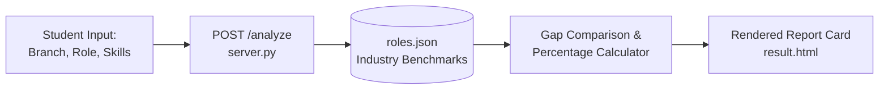

# 🚀 Smart Multi-Branch Career Skill Gap Detector

[](https://www.python.org/)
[](https://docs.python.org/3/library/http.server.html)
[](https://pypi.org/)
[](LICENSE)

A web-based engineering career advising application built with pure Python that compares a student's current skill profile against industry role requirements, computes a role readiness match score, and generates a tailored learning roadmap.

---

## 🌟 Key Features

- **Multi-Branch Coverage:** Supports 6 engineering disciplines:
  - Computer Science & Engineering (CS)
  - Mechanical Engineering
  - Electronics & Communication (ECE)
  - Electrical & Electronics (EEE)
  - VLSI Design & Embedded Systems
  - Civil Engineering
- **Automated Skill Deficit Analysis:** Identifies precise missing technical competencies.
- **Match Readiness Score:** Computes real-time percentage readiness.
- **Dynamic Learning Roadmap:** Generates structured step-by-step roadmaps to close identified skill gaps.
- **Zero External Dependencies:** Built entirely with Python's standard library (`http.server`, `urllib.parse`, `json`).

---

## 🏗️ Architecture & Data Flow



---

## 🛠️ Tech Stack

| Component | Technology | Role |
| :--- | :--- | :--- |
| **Backend** | Python (`http.server`) | HTTP request routing and score computation |
| **Data Store** | JSON (`roles.json`) | Engineering branch skill taxonomies & roadmaps |
| **Frontend** | HTML5 & CSS3 | User input interface & visual dashboard |

---

## ⚙️ How It Works

1. **Select Branch:** Choose your engineering domain.
2. **Select Target Role:** Choose desired career specializations.
3. **Enter Skills:** Input acquired technical skills (comma-separated).
4. **Instant Diagnostic:** Receive readiness percentage, missing prerequisites, and customized curriculum roadmap.

---

## 🚀 Getting Started

### Prerequisites
- Python 3.8+ (No `pip install` required!)

### 1. Clone the Repository
```bash
git clone https://github.com/usha1101/skill-gap-detector.git
cd skill-gap-detector
```

### 2. Run the Local Server
```bash
python server.py
```

### 3. Open in Browser
Navigate to:  
`http://localhost:8000`

---

## 📸 Application Screenshots

<p align="center">
  
</p>

<p align="center">
  
</p>

<p align="center">
  
</p>

---

## 📂 Repository Structure

```text
skill-gap-detector/
├── .gitignore       # Python cache rules
├── README.md        # Project guide and architecture documentation
├── index.html       # Student input form
├── result.html      # Analysis results and roadmap template
├── roles.json       # Industry role skills taxonomy and roadmap dictionary
├── server.py        # Lightweight HTTP server & analytical engine
└── style.css        # Clean UI styling
```

---

## 👩‍💻 Author

**Ushashree M**  
- B.Tech Artificial Intelligence & Data Science, Reva University  
- GitHub: [@usha1101](https://github.com/usha1101)  

---

## 📄 License

This project is licensed under the [MIT License](LICENSE).
